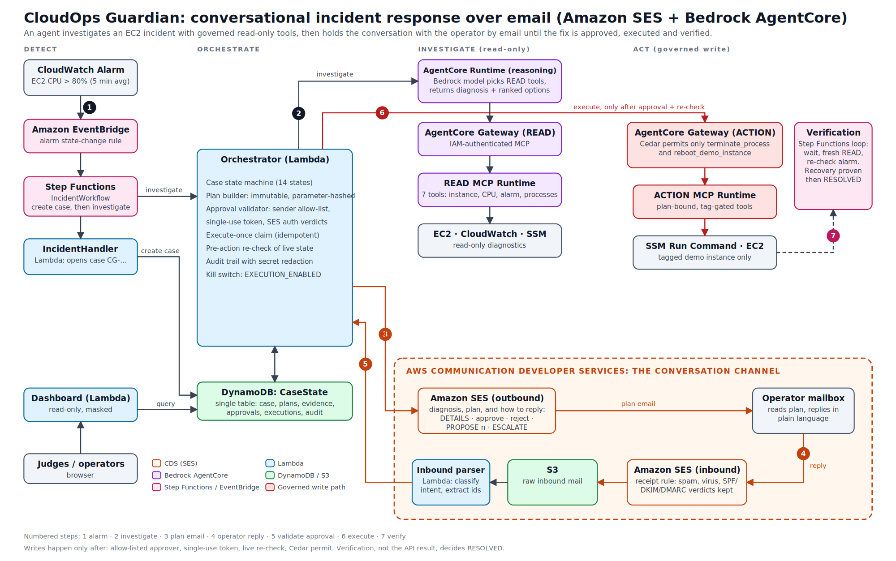

# CloudOps Guardian

*An AI agent that investigates your outage and asks permission by email to resolve it.*

An incident-response agent that **talks to you by email**. When an EC2 alarm fires, an agent on Amazon Bedrock AgentCore investigates with governed read-only tools, emails the on-call operator a diagnosis and a proposed fix, and keeps the conversation going over **Amazon SES** until the operator approves, the fix runs, and recovery is verified.

Built for the AWS CDS Agentic AI Partner Hackathon. Communication runs through Amazon SES in both directions: outbound plans and answers, inbound replies that are parsed, authenticated and routed back to the right case.



Full write-up: [docs/DESCRIPTION.md](docs/DESCRIPTION.md).

## For judges: three ways to evaluate

Deploying the whole system needs a dedicated AWS account, an SES domain, Bedrock model access and several manually created AgentCore resources, so we do not expect you to. You can evaluate it at three levels:

| Level | What you need | Time |
|---|---|---|
| **1. See it running** | Nothing. Watch the demo video and open the live dashboard (both linked in the Devpost submission). The dashboard is read-only and shows real cases from our test runs: alarm, evidence, plan, approval, execution and verification. | 5 min |
| **2. Run the tests** | `uv` and Python 3.12. No AWS account or credentials. Run `./run-tests.sh`: 278 tests covering the case state machine, approval validation, execute-once claim, email parsing, reasoning guardrails and the READ tools. All AWS calls are mocked. | 1 min |
| **3. Deploy it** | A sandbox AWS account and about half a day. Follow [SETUP.md](SETUP.md): a manual checklist for the foundation, then scripted deploys. | hours |

Where to look in the code, if you read it:
- Approval rules: `orchestrator/src/cloudops_orchestrator/approval_validator.py`
- Execute-once and pre-action re-check: `orchestrator/src/cloudops_orchestrator/executor.py`
- Agent guardrails: `reasoning/agent.py`
- Governed write tools and the Cedar permits: `foundation/action_mcp/` and `foundation/cedar/`
- Where SES is used: `orchestrator/src/cloudops_orchestrator/clients/ses_outbound.py` (send) and `inbound_parser/lambda_function.py` (receive)

## How it works

1. A CloudWatch alarm starts a Step Functions workflow that opens a case in DynamoDB.
2. The Orchestrator Lambda asks the reasoning agent (AgentCore Runtime) to investigate. The agent can only reach the READ gateway.
3. The operator receives an email with evidence, risk, and the commands they can reply with: `DETAILS`, a free-text question, `APPROVE PLAN-… <token>`, `REJECT`, `PROPOSE <n>`, `ESCALATE`.
4. Replies arrive through SES, land in S3, and are classified by the parser Lambda, which hands them to the Orchestrator.
5. An approval is honoured only if: the sender is an approver, the single-use token matches, SES verdicts pass, and a fresh re-check of the live instance still agrees. The action then goes through the ACTION gateway, where a Cedar policy permits exactly two tools.
6. A verification workflow re-reads the instance until recovery is proven. Only then is the case `RESOLVED`.

A read-only dashboard (Lambda Function URL) shows cases, plans, evidence and a timeline. It has no approve button.

## Repository layout

| Path | What |
|---|---|
| `orchestrator/` | Orchestrator Lambda: case state machine, plans, approvals, executor, verification |
| `inbound_parser/` | Lambda that parses SES inbound mail (v1.1) |
| `reasoning/` | AgentCore reasoning agent (Strands) with guardrails |
| `mcp_read/` | READ MCP server (7 tools) |
| `foundation/` | Source of the pieces created before the orchestrator: IncidentHandler Lambda, ACTION MCP server, Cedar policies |
| `dashboard/` | Read-only dashboard Lambda |
| `deploy/` | IAM policies, Step Functions definitions, SSM document, deploy and test scripts |
| `render.py`, `config.env.example` | Fill in your account values (see below) |

## Before you deploy

This project creates IAM roles and policies, Lambda functions, Step Functions, an SES identity and receipt rule, S3, DynamoDB, and AgentCore runtimes and gateways. **Use a sandbox AWS account**, read the policies in `deploy/iam/` first, and expect to run the scripts with an admin identity (they were designed for AWS CloudShell).

Safety defaults you should know about:
- Approvals **execute** by default in `deploy-orchestrator.sh`. Deploy with `EXECUTION=off` for dry-run approvals, or flip it any time with `deploy/set-execution.sh off`.
- Actions only apply to an EC2 instance tagged `AgentRemediation=Enabled`.
- Receiving an incident email is not permission to approve: operators and approvers are separate lists.

## Quick start

1. `cp config.env.example config.env` and fill it in. Several IDs come from resources you create in step 2 of [SETUP.md](SETUP.md).
2. Follow [SETUP.md](SETUP.md): foundation resources first, then the deploy scripts in order.
3. `python3 render.py` writes your account-specific copy of `deploy/` and the two MCP servers to `rendered/`. Run the scripts, and package the MCP servers, from there.
4. Trigger the demo (see "Try it" in SETUP.md) and watch the case in the dashboard.

## Tests

```bash
./run-tests.sh      # all suites, no AWS account needed
```

## Cost and teardown

Everything is pay-per-use (Lambda, DynamoDB on-demand, SES, Step Functions, AgentCore, Bedrock), plus the demo EC2 instance. Delete the resources named `CloudOpsGuardian-*`, the two AgentCore gateways and runtimes, the SES receipt rule, and the S3 buckets to stop all charges. The table has deletion protection on; turn it off first.

## License

Private repository, all rights reserved. Shared with the AWS CDS Agentic AI Partner Hackathon judges for evaluation only.
